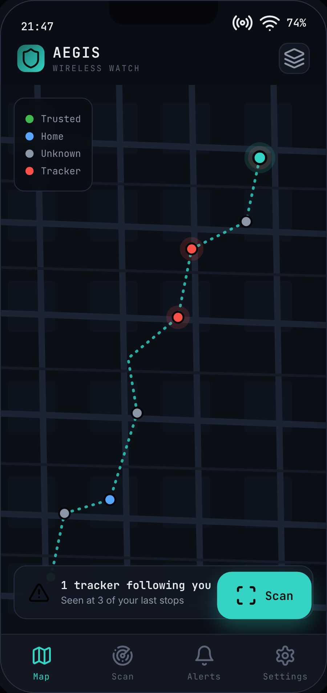
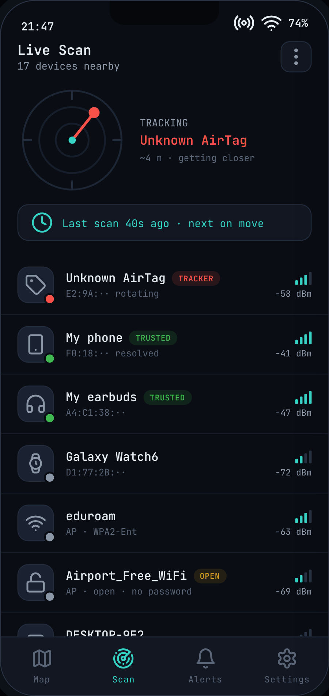
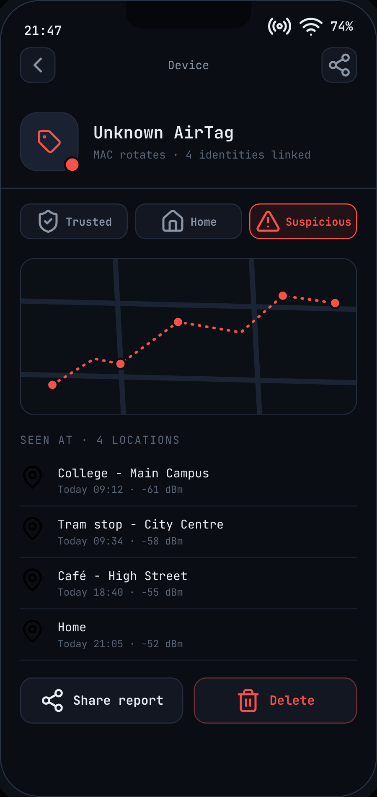
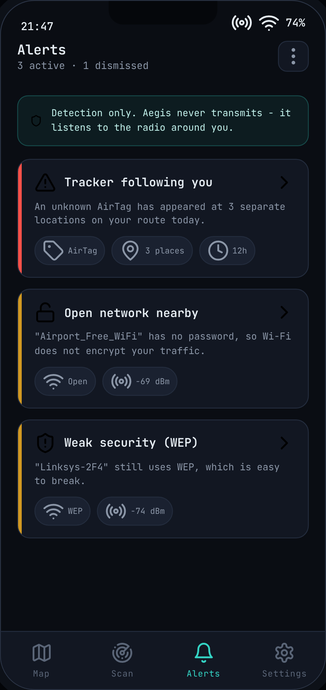
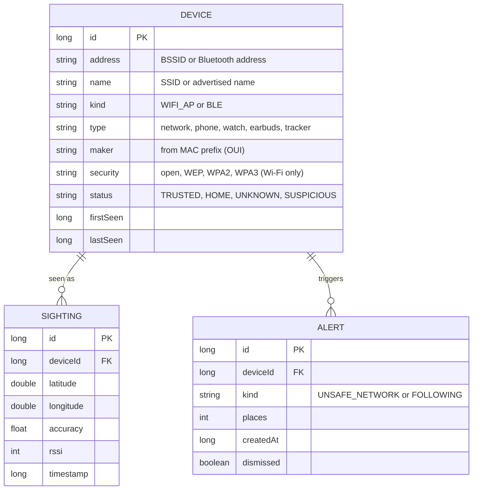

<h1 align="center">Aegis Scanner</h1>

<p align="center">
  <b>Privacy-first Android scanner: maps nearby Wi-Fi networks and Bluetooth devices along your route and flags trackers that keep following you. Listens only, data stays on the phone.</b>
</p>

<p align="center">
  
  
  
  
</p>

<p align="center">
  
  
  
  
</p>
<p align="center"><sub>Early mockups - the real app will look different as it develops.</sub></p>

---

## Contents

- [Status](#status)
- [Why Aegis](#why-aegis)
- [What it does](#what-it-does)
- [Roadmap](#roadmap)
- [Screens](#screens)
- [How tracker detection will work](#how-tracker-detection-will-work)
- [Battery and Android scan limits](#battery-and-android-scan-limits)
- [Tech stack](#tech-stack)
- [Sensors](#sensors)
- [Data model](#data-model)
- [Permissions](#permissions)
- [Privacy and ethics](#privacy-and-ethics)
- [Known limitations](#known-limitations)
- [Development setup](#development-setup)
- [Project structure](#project-structure)
- [Course context](#course-context)
- [License](#license)
- [Author](#author)

---

## Status

**Early development - no code yet.** The project plan was approved, and the scope was revised after lecturer feedback (October 2026). This README describes the plan and the decisions made so far. Everything marked *planned* may change.

Aegis started as the project for the Mobile Development module at Griffith College Dublin (2026/27). The goal is to release it publicly once it is stable.

---

## Why Aegis

The radio around you is invisible. Every phone, watch, pair of earbuds and Wi-Fi router nearby is broadcasting, and you have no easy way to see it.

That matters in two everyday situations:

- **Unwanted tracking.** Small Bluetooth trackers such as AirTags are cheap and easy to hide in a bag or a car. Police reports and news stories have shown them being used to follow people and to find cars to steal.
- **Unsafe Wi-Fi.** Open or WEP-protected networks in cafés, airports and hotels offer little or no protection for your traffic.

Android already shows basic alerts for some unknown trackers. Aegis goes further by keeping a **map of where each device was seen**, so you can look back at your route and judge for yourself - and by checking the **Wi-Fi networks** around you. All of this happens on the phone, without accounts and without Google services.

---

## What it does

1. **Scans** nearby Wi-Fi networks (and, from v2, Bluetooth LE devices).
2. **Saves** every scan with your GPS location in a local database.
3. **Shows** everything on a map: your route, where each scan happened and which devices were around.
4. **Warns** you about unsafe networks and, from v2, about devices that seem to follow you.

Every device gets a status and a colour on the map:

| Colour | Status | Meaning |
|:---:|---|---|
| 🟢 | **Trusted** | Your own devices (phone, earbuds, watch). Never trigger alerts. |
| 🔵 | **Home** | Devices that live at home (router, TV, neighbours' networks). Never trigger alerts. |
| ⚪ | **Unknown** | Everything else. Most devices stay here. |
| 🔴 | **Suspicious** | A device that keeps appearing in different places you go, or one you marked yourself. |

---

## Roadmap

### v1 - Wi-Fi networks *(first target)*

- [ ] Project skeleton (Kotlin, Compose, Gradle)
- [ ] Manual Wi-Fi scan: name (SSID), BSSID, security type (open / WEP / WPA2 / WPA3), signal strength
- [ ] Save each scan with GPS location (Room)
- [ ] Map screen with route and network markers (MapLibre + OpenStreetMap)
- [ ] Device Detail: history of one network, tag as trusted / home / suspicious
- [ ] Alerts for unsafe networks (open, WEP)
- [ ] Trusted Devices and Settings screens
- [ ] Share report (`ACTION_SEND`) and open Wi-Fi settings (`ACTION_WIFI_SETTINGS`)

### v2 - Bluetooth and trackers

- [ ] Bluetooth LE scanning
- [ ] Recognise common tracker types from their broadcast data
- [ ] "Following you" detection across places (see [below](#how-tracker-detection-will-work))
- [ ] Compass arrow on Live Scan to walk towards a selected device ("hot / cold")

### v3 - Smarter scanning

- [ ] Trip mode: scans only while you are moving (accelerometer)
- [ ] Measure battery use per hour and tune scan timing
- [ ] Offline map tiles, so the app needs no network at all

### Decided against

- **Hidden camera detection** - a camera connected to a normal Wi-Fi network does not broadcast anything the phone can see, so detection would be unreliable.
- **Magnetometer "metal detector"** - too unreliable to be useful.
- **Anything that transmits or interferes** with other devices. Aegis is and will stay a passive, detection-only tool.

---

## Screens

| Screen | What it shows | Version |
|---|---|:---:|
| **Map** (home) | Your route, scan points and colour-coded devices | v1 |
| **Live Scan** | Networks and devices from the latest scan, strongest signal first; compass arrow to a selected device | v1 / v2 |
| **Device Detail** | Where one device was seen, its signal history, status buttons, Share report | v1 |
| **Alerts** | Unsafe networks (v1), trackers following you (v2) | v1 / v2 |
| **Trusted Devices** | Add, rename or delete your own devices | v1 |
| **Settings** | Scan frequency, detection sensitivity, Trip mode | v1 / v3 |

---

## How tracker detection will work

*Planned for v2. The exact rules and numbers will be tuned with real data.*

1. Every scan stores a **sighting**: which device, where you were, when, and how strong the signal was.
2. Devices marked **Trusted** or **Home** are ignored.
3. A device becomes **suspicious** when it is seen at **several different places** that are **far enough apart**, within a **limited time window**, **while you were moving**.
4. The "while moving" part uses the accelerometer. It stops false alarms from devices that simply sit next to you, for example in a café.

**The hard part:** trackers and phones change their Bluetooth address from time to time to protect privacy. Recognising the *same* tracker after it changes address is the main research problem of v2.

---

## Battery and Android scan limits

Constant scanning would drain the battery. Android also does not allow it:

| Scan type | Android limit |
|---|---|
| Wi-Fi, app on screen | 4 scans per 2 minutes |
| Wi-Fi, background | 1 scan per 30 minutes **for all background apps together** |
| Bluetooth LE | Limited number of scan starts in a short period; low-power scan mode available |

So Aegis will:

- scan when you press **Scan**;
- in **Trip mode**, scan only while the accelerometer says you are moving, inside a visible foreground service;
- use Android's **low-power Bluetooth scan mode**;
- never run a hidden, always-on background scan.

> **Dev tip:** Wi-Fi scan throttling can be switched off for local testing in *Developer options → Networking → Wi-Fi scan throttling*.

---

## Tech stack

| Area | Choice | Notes |
|---|---|---|
| Language | **Kotlin** | |
| UI | **Jetpack Compose** (Material 3) | |
| Map | **MapLibre Native for Android** + **OpenStreetMap** data | Open source. Tile source planned: OpenFreeMap. No Google Maps. |
| Storage | **Room** (SQLite) | Local only |
| Location | Android platform `LocationManager` | No Google Play Services, so it also runs on de-Googled Android |
| Sensors | Android `SensorManager` | Accelerometer, magnetometer (rotation vector) |
| Background work | Foreground service (Trip mode), WorkManager | |
| Build | Gradle (Kotlin DSL) | |
| SDK *(planned)* | `minSdk 31` (Android 12), `targetSdk` / `compileSdk 36` | Android 12+ has the modern Bluetooth permission model |
| Editor | Neovim (LazyVim) + Gradle CLI | Android Studio is optional |

---

## Sensors

| Sensor | Used for |
|---|---|
| **GPS** | Tagging every scan with a location; drawing the route; spotting a device that appears in several places |
| **Magnetometer** + accelerometer (rotation vector) | Compass arrow towards a selected device; turning the map to face the way you walk |
| **Accelerometer** | Knowing if you are walking or still - for the "following" check and for battery-saving Trip mode |

---

## Data model

All data lives on the phone in a Room database. Three tables:



**CRUD**

- **Create** - devices and sightings are added on every scan; trusted devices can be added by hand.
- **Read** - the map, lists and Device Detail load from the database.
- **Update** - rename a device or change its status.
- **Delete** - delete a device, clear its history, or dismiss an alert.

---

## Permissions

*Planned. Each one is requested only when the feature that needs it is used.*

| Permission | Why |
|---|---|
| `ACCESS_FINE_LOCATION` | GPS location for every scan. Android also requires it to read Wi-Fi scan results, even on Android 13+. |
| `ACCESS_WIFI_STATE`, `CHANGE_WIFI_STATE` | Start Wi-Fi scans and read the results |
| `BLUETOOTH_SCAN` *(v2)* | Bluetooth LE scanning. Declared **without** `neverForLocation`: Aegis does link devices to places, and that flag would also filter some Bluetooth beacons out of the results. |
| `FOREGROUND_SERVICE`, `FOREGROUND_SERVICE_LOCATION` *(v3)* | Trip mode runs as a visible foreground service |
| `POST_NOTIFICATIONS` | Alerts (Android 13+) |
| `INTERNET` | Map tiles only |

Android also requires **Location services to be switched on** to return Wi-Fi scan results. The plan is to avoid `ACCESS_BACKGROUND_LOCATION` by running Trip mode as a foreground service that the user starts.

---

## Privacy and ethics

- **Detection only.** Aegis only listens to signals that devices already broadcast. It never connects to, transmits to, or interferes with other devices.
- **Your data stays on your phone.** No accounts, no analytics, no server. Data leaves the phone only when you tap **Share report**.
- **The one network request is map tiles.** The tile server can see which map area you are looking at, but never your scan data. Offline tiles are planned to remove even that.
- **No Google Play Services** and no proprietary map SDKs.
- **Built to protect yourself.** Aegis is meant to help people check whether they are being followed and whether a network is safe to use. Do not use it to track other people, and follow the law where you live.

---

## Known limitations

- A phone can only see devices that **broadcast** something. Devices that stay silent are invisible to Aegis.
- Trackers and phones **change their Bluetooth address**, which makes it hard to recognise the same device over time.
- Android **limits how often** apps can scan Wi-Fi (see [above](#battery-and-android-scan-limits)).
- Signal strength gives only a **rough idea of distance** - walls and bodies change it a lot.
- **GPS is weak indoors**, so locations inside buildings can be off.
- Many legitimate networks share one name across lots of access points (for example `eduroam`), which makes "fake network" detection noisy. It is not in the current plan.

---

## Development setup

*The project skeleton is not in the repository yet. These are the planned requirements and commands.*

**Requirements**

- JDK 17 or newer
- Android SDK command-line tools with `platform-tools`, `platforms;android-36`, `build-tools;36.0.0`
- An Android 12+ phone with USB or wireless debugging enabled (main test device runs Android 14)
- Optional: [`scrcpy`](https://github.com/Genymobile/scrcpy) to mirror the phone screen on your computer

Android Studio is **not** required. The project is a standard Gradle project, so it opens in Android Studio too.

**Build and run**

```bash
./gradlew assembleDebug     # build a debug APK
./gradlew installDebug      # install it on the connected phone
adb logcat                  # read the app's logs
scrcpy                      # mirror the phone screen
```

---

## Project structure

*Planned.*

```text
app/src/main/java/<package>/
├── ui/          Compose screens and navigation
├── scan/        Wi-Fi and Bluetooth scanners
├── sensors/     location, motion and compass
├── detection/   rules for unsafe networks and trackers
└── data/        Room entities, DAOs and repository
docs/
└── mockups/     early screen designs
```

---

## Course context

Built for the **Mobile Development** module at **Griffith College Dublin**, 2026/27.

| Module requirement | How Aegis meets it |
|---|---|
| 3+ distinct pages | Six screens (see [Screens](#screens)) |
| Explicit intent | Tapping a map marker or list row opens Device Detail |
| Implicit intent | Share report (`ACTION_SEND`), open Wi-Fi settings (`ACTION_WIFI_SETTINGS`) |
| Sensor use | GPS, magnetometer, accelerometer |
| Storage with CRUD | Room database with three tables |

**Feedback received on the proposal** - camera detection may not be implementable, and constant scanning would drain the battery; start with a simpler version that checks nearby networks. The scope was revised accordingly: v1 focuses on Wi-Fi networks, camera detection was dropped, and scanning is event-driven instead of constant.

---

## License

Not chosen yet.

---

## Author

**Vladimir Rainov** - [vladr.tech](https://vladr.tech) · [@PeGoPaz](https://github.com/PeGoPaz)
